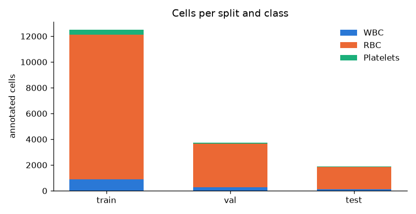
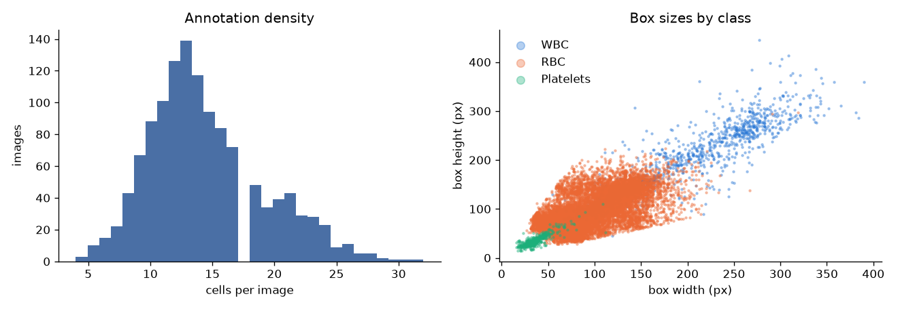
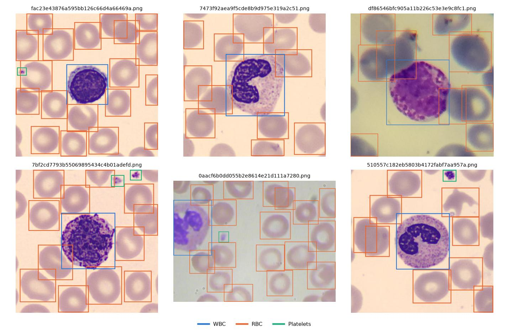

# TXL-PBC Dataset Report

Peripheral blood smear images annotated for object detection in YOLO format. Each cell has a bounding box and one of three classes: WBC, RBC, Platelets.

## Splits

| Split | Images | Cells | WBC | RBC | Platelets | Cells / image |
|---|---:|---:|---:|---:|---:|---:|
| train | 882 | 12,510 | 908 | 11,220 | 382 | 14.2 |
| val | 252 | 3,752 | 257 | 3,383 | 112 | 14.9 |
| test | 126 | 1,881 | 133 | 1,699 | 49 | 14.9 |
| **total** | **1,260** | **18,143** | 1,298 | 16,302 | 543 | 14.4 |

## Class balance

| Class | Cells | Share | Mean box (px, w × h) |
|---|---:|---:|---:|
| WBC | 1,298 | 7.2% | 190 × 193 |
| RBC | 16,302 | 89.9% | 95 × 95 |
| Platelets | 543 | 3.0% | 36 × 36 |

RBCs dominate the annotations. Each image holds between 4 and 32 cells (median 14).

## Images

- 5 distinct resolutions; most common: 575x575 (500), 360x363 (486), 640x480 (160), 256x256 (100)
- Color modes: RGB (1160), RGBA (100). RGBA images are converted to 3-channel on load.

## Validation

Archive CRC check passed; every image has a matching label file; every label row was checked for 5 fields, class id in 0–2 and coordinates in [0, 1].

> Note: the original `Data/TXL-PBC.zip` in this folder was corrupted (binary bytes replaced by U+FFFD during a text-mode transfer). It was replaced with a fresh download from the same source (SHA-256 `ac1a0281…5403f`).
