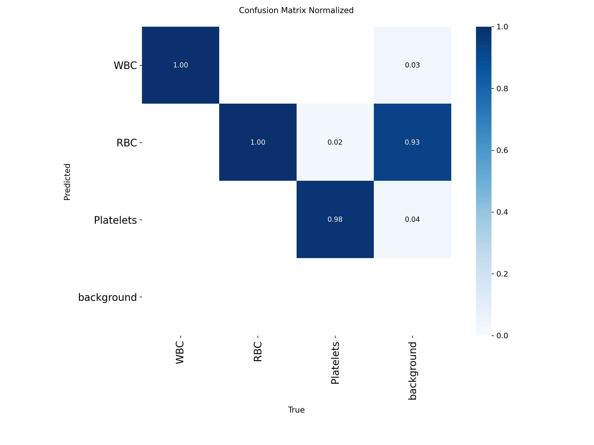
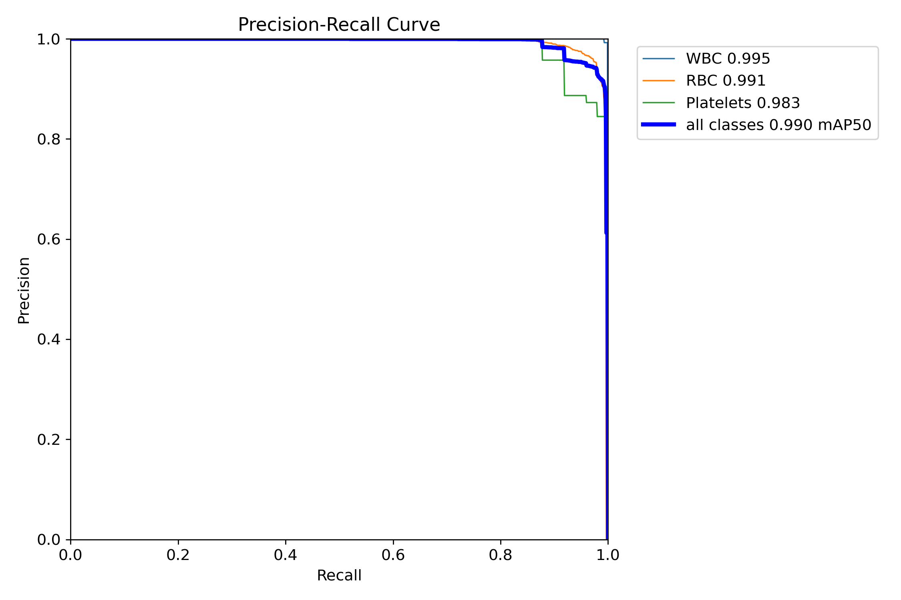
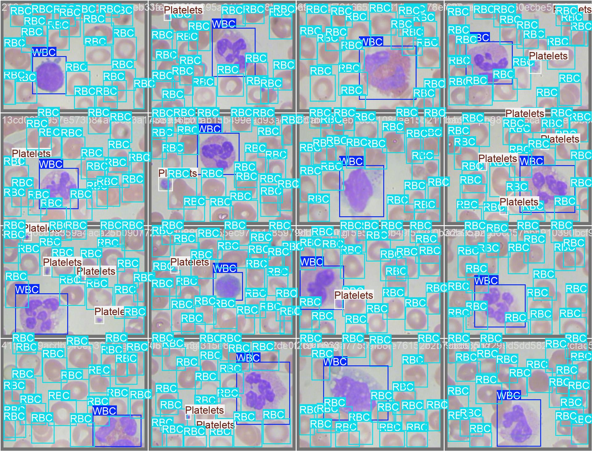
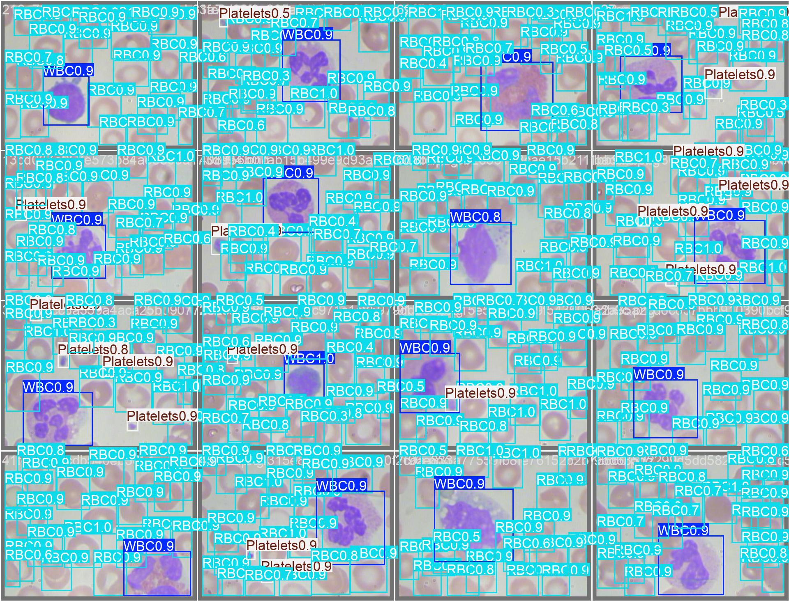

# Model Performance Report

Best checkpoint (`best.pt`, epoch 86) evaluated on the **held-out test split** (126 images, 1,881 cells), which was never used for training or model selection.

## Overall

| Precision | Recall | mAP50 | mAP50-95 |
|---:|---:|---:|---:|
| 0.974 | 0.948 | 0.990 | 0.877 |

## Per class

| Class | Precision | Recall | mAP50 | mAP50-95 |
|---|---:|---:|---:|---:|
| WBC | 0.996 | 0.992 | 0.995 | 0.900 |
| RBC | 0.980 | 0.933 | 0.991 | 0.907 |
| Platelets | 0.945 | 0.918 | 0.983 | 0.823 |

Inference speed on Tesla T4: 14.2 ms/image (preprocess 0.8 ms, postprocess 0.8 ms).

## Confusion matrix (normalized)

## Precision–recall curve

## Test predictions vs. ground truth

| Ground truth | Prediction |
|---|---|
|  |  |
