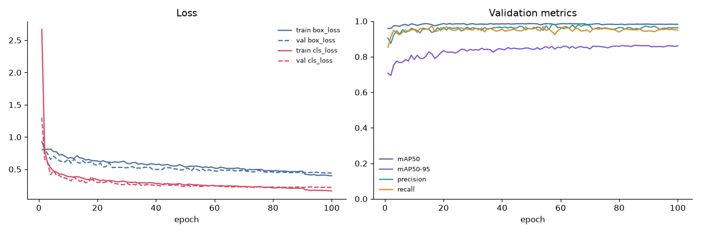

# Training Progress Report

## Run configuration

| Setting | Value |
|---|---|
| model | yolo26s.pt |
| epochs | 100 |
| imgsz | 640 |
| batch | 16 |
| patience | 30 |
| seed | 42 |
| gpu | Tesla T4 |
| ultralytics | 8.4.198 |
| torch | 2.11.0+cu130 |

## Progress

- Epochs run: **100** of 100
- Best epoch (validation mAP50-95): **86**, mAP50 0.984, mAP50-95 0.864
- Final epoch: train box loss 0.400, val box loss 0.441

## Validation metrics by epoch (every 10th + last)

| Epoch | train box | train cls | val box | val cls | P | R | mAP50 | mAP50-95 |
|---:|---:|---:|---:|---:|---:|---:|---:|---:|
| 10 | 0.673 | 0.387 | 0.656 | 0.344 | 0.955 | 0.953 | 0.982 | 0.784 |
| 20 | 0.629 | 0.341 | 0.568 | 0.297 | 0.963 | 0.956 | 0.987 | 0.834 |
| 30 | 0.594 | 0.303 | 0.525 | 0.286 | 0.963 | 0.950 | 0.986 | 0.837 |
| 40 | 0.573 | 0.278 | 0.496 | 0.248 | 0.963 | 0.954 | 0.985 | 0.842 |
| 50 | 0.534 | 0.256 | 0.504 | 0.239 | 0.957 | 0.957 | 0.986 | 0.842 |
| 60 | 0.518 | 0.244 | 0.475 | 0.247 | 0.965 | 0.957 | 0.985 | 0.851 |
| 70 | 0.509 | 0.235 | 0.491 | 0.234 | 0.973 | 0.938 | 0.982 | 0.843 |
| 80 | 0.475 | 0.211 | 0.456 | 0.227 | 0.965 | 0.939 | 0.982 | 0.858 |
| 86 | 0.463 | 0.208 | 0.448 | 0.222 | 0.959 | 0.951 | 0.984 | 0.864 |
| 90 | 0.472 | 0.211 | 0.446 | 0.219 | 0.968 | 0.946 | 0.984 | 0.862 |
| 100 | 0.400 | 0.166 | 0.441 | 0.221 | 0.963 | 0.950 | 0.983 | 0.861 |
