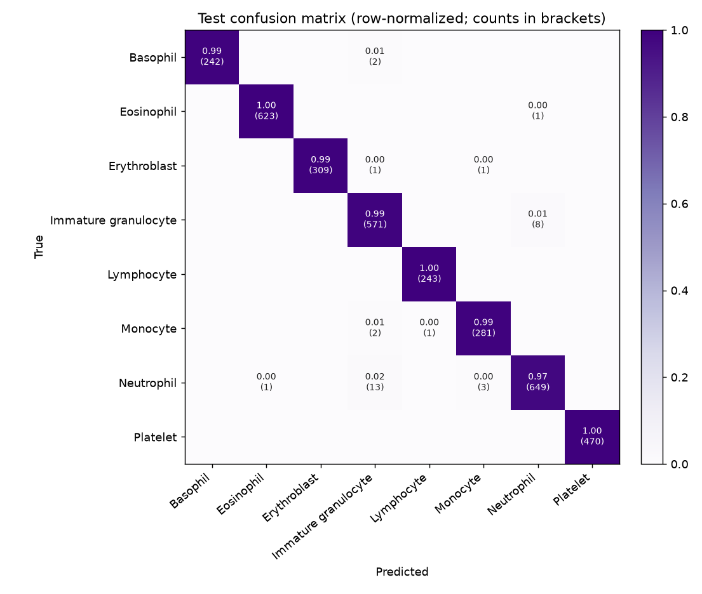
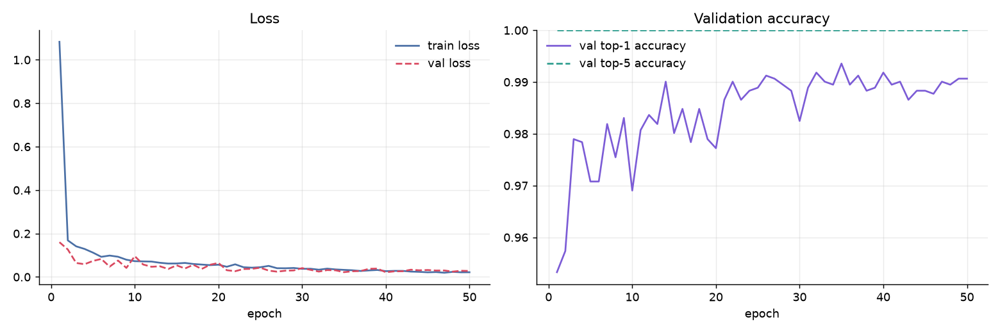
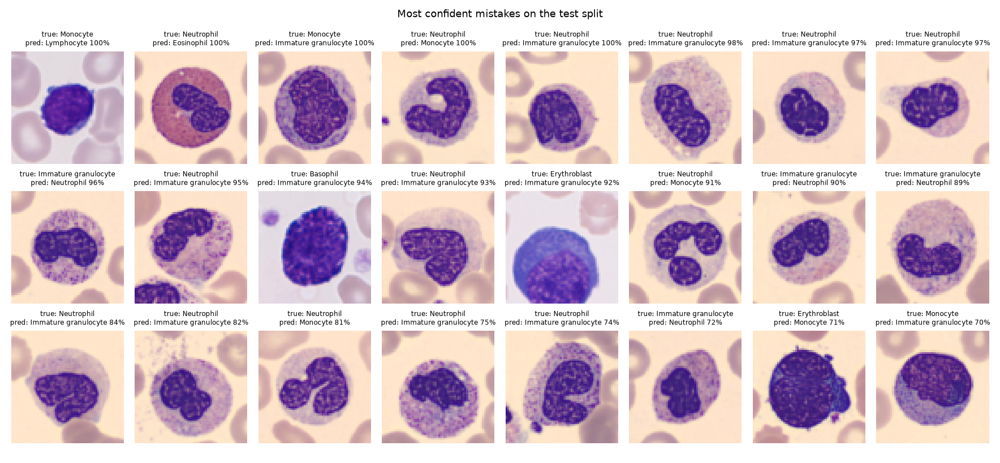

# White Blood Cell Classifier Report

Second model of the project: classifies a single-cell image into one of 8 blood cell types. It is separate from the TXL-PBC detector (tag `detector-v1`), which finds and counts cells in smear images.

- **Model:** `yolo26s-cls.pt` fine-tuned on BloodMNIST (64x64), image size 224 px
- **Training:** 50 epochs run (max 60, early-stop patience 15), batch 128, GPU: Tesla T4
- **Best epoch:** 35 (val top-1 accuracy 99.4%)
- **Weights:** `outputs/wbc_classifier/.../wbc_best.pt`

## Test results

Held-out **test split** (3,421 images), never used for training or model selection.

| Accuracy | Balanced accuracy | Macro F1 | Top-2 accuracy |
|---:|---:|---:|---:|
| 99.0% | 99.2% | 0.992 | 99.9% |

Validation split: accuracy 99.4%, macro F1 0.994.

## Per class (test)

| Class | Precision | Recall | F1 | Test images |
|---|---:|---:|---:|---:|
| Basophil | 1.000 | 0.992 | 0.996 | 244 |
| Eosinophil | 0.998 | 0.998 | 0.998 | 624 |
| Erythroblast | 1.000 | 0.994 | 0.997 | 311 |
| Immature granulocyte | 0.969 | 0.986 | 0.978 | 579 |
| Lymphocyte | 0.996 | 1.000 | 0.998 | 243 |
| Monocyte | 0.986 | 0.989 | 0.988 | 284 |
| Neutrophil | 0.986 | 0.974 | 0.980 | 666 |
| Platelet | 1.000 | 1.000 | 1.000 | 470 |

Weakest class by recall: **Neutrophil** (97.4%); it is most often mistaken for **Immature granulocyte** (13 of 666 test images).

## Confusion matrix

## Training curves

## Most confident mistakes

## Data check

Pixel-identical images shared between splits: train/test 5, train/val 3, val/test 1. With 3,421 test images this is too small to affect the reported accuracy (0.15% of the test split).

## Limitations

- BloodMNIST images are centered single cells at 64 × 64 px from one source. Accuracy on cells cropped from other smears (for example TXL-PBC detections or a live microscope camera) is not measured here and may be lower, since those images differ in scale, stain and framing.
- Classes are imbalanced in training (849 lymphocytes vs 2,330 neutrophils); see per-class recall above.
- For research and education only; not a diagnostic device.
